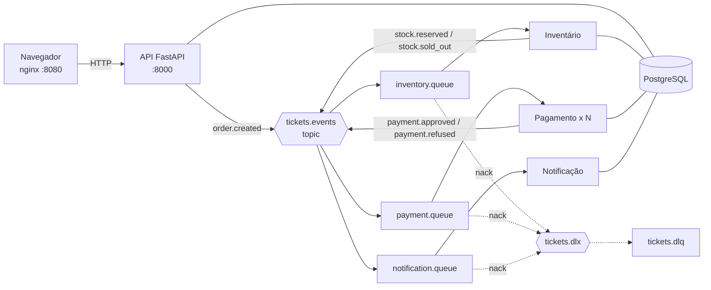

# Voucher

Sistema de venda de ingressos (estilo Sympla) construído para a disciplina de Programação Distribuída, Paralela e Concorrente. A API recebe o pedido, publica um evento no RabbitMQ e responde na hora. Três microsserviços (Inventário, Pagamento e Notificação) processam o pedido de forma independente, por coreografia de eventos.

## Sumário

- [O que o projeto demonstra](#o-que-o-projeto-demonstra)
- [Arquitetura](#arquitetura)
- [Pré-requisitos](#pré-requisitos)
- [Como executar](#como-executar)
  - [Para parar e recomeçar](#para-parar-e-recomeçar)
- [Configuração (`.env`)](#configuração-env)
- [Roteiro de testes](#roteiro-de-testes)
  - [Fluxo normal](#fluxo-normal)
  - [Queda de serviço (etapa 4)](#queda-de-serviço-etapa-4)
  - [Dead Letter Queue (etapa 4)](#dead-letter-queue-etapa-4)
  - [Escalabilidade (etapa 5)](#escalabilidade-etapa-5)
  - [Reembolso](#reembolso)
- [Scripts (`scripts/`)](#scripts-scripts)
- [Imagens dos eventos](#imagens-dos-eventos)
- [Endpoints principais](#endpoints-principais)
- [Estrutura de pastas](#estrutura-de-pastas)
- [Solução de problemas](#solução-de-problemas)
- [Colaboradores](#colaboradores)

## O que o projeto demonstra

| Etapa | O que está implementado |
|---|---|
| 1. Produtor | A API valida o pedido, publica `order.created` e responde 202 "Pedido Recebido / Em Processamento" |
| 2. Roteamento | Exchange `topic` (`tickets.events`) com um mesmo evento chegando a várias filas; fluxo encadeado `order.created` → `stock.reserved` → `payment.approved` |
| 3. Confiabilidade | Filas duráveis, `delivery_mode=2`, `auto_ack=False` e `basic_ack` só após o sucesso |
| 4. Falhas | DLX `tickets.dlx` e DLQ `tickets.dlq` com `basic_nack(requeue=False)`; mensagens retidas quando um consumidor cai |
| 5. Escala | Várias réplicas do Pagamento na mesma fila (competing consumers) com `prefetch` 1 |

## Arquitetura



Fluxo de uma compra:

1. A API grava o pedido e publica `order.created`.
2. O Inventário reserva o estoque e publica `stock.reserved` (ou `stock.sold_out`).
3. O Pagamento cobra e publica `payment.approved` (ou `payment.refused`).
4. O Inventário confirma o estoque (ou libera, se recusado) e credita os ingressos ao usuário.
5. A Notificação registra os e-mails dos eventos do pedido.

Mapeamento de filas:

| Fila | Routing keys | Consumidor |
|---|---|---|
| `inventory.queue` | `order.created`, `payment.approved`, `payment.refused`, `ticket.refund_requested` | Inventário |
| `payment.queue` | `stock.reserved`, `stock.sold_out` | Pagamento |
| `notification.queue` | `order.created`, `payment.approved`, `payment.refused`, `ticket.refunded` | Notificação |
| `tickets.dlq` | `dead` (via `tickets.dlx`) | nenhum, análise manual |

## Pré-requisitos

- Docker Desktop (com Docker Compose v2) em execução.
- Portas livres: `8080` (site), `8000` (API), `5672` e `15672` (RabbitMQ).
- Nenhuma instalação de Python ou Node é necessária: tudo roda em containers.

## Como executar

1. Entre na pasta do projeto.

2. Crie o arquivo de ambiente a partir do modelo.

   ```bash
   cp .env.example .env
   ```

   No PowerShell: `Copy-Item .env.example .env`.

3. Suba tudo, construindo as imagens.

   ```bash
   docker compose up -d --build
   ```

4. Confira se os 7 containers estão de pé (`postgres`, `rabbitmq`, `api`, `inventory-service`, `payment-service`, `notification-service` e `frontend`).

   ```bash
   docker compose ps
   ```

5. Abra os endereços.

   | O quê | Endereço |
   |---|---|
   | Site | http://localhost:8080 |
   | API (documentação Swagger) | http://localhost:8000/docs |
   | Saúde da API | http://localhost:8000/health |
   | Painel do RabbitMQ | http://localhost:15672 (usuário e senha do `.env`) |

6. No site, crie uma conta, escolha um evento e compre. Acompanhe o pedido na tela e nos logs.

   ```bash
   docker compose logs -f payment-service
   ```

Atalho: `scripts/setup.sh` faz os passos 2 e 3 e mostra os endereços.

### Para parar e recomeçar

| Objetivo | Comando |
|---|---|
| Parar, mantendo os dados | `docker compose down` |
| Parar e **apagar banco e filas** | `docker compose down -v` |
| Recriar do zero | `docker compose down -v` e depois `docker compose up -d --build` |

O Postgres só lê `infra/postgres/init.sql` quando o volume é criado. Se você mudar o esquema ou os eventos de exemplo, precisa do `down -v`.

## Configuração (`.env`)

| Variável | Padrão | Função |
|---|---|---|
| `POSTGRES_USER`, `POSTGRES_PASSWORD`, `POSTGRES_DB` | `tickets`, `tickets_pass`, `tickets` | Acesso ao banco |
| `RABBITMQ_USER`, `RABBITMQ_PASSWORD` | `tickets`, `tickets_pass` | Acesso ao broker e ao painel |
| `PAYMENT_LIMIT` | `20000.00` | Pedidos acima desse valor são recusados e vão para a DLQ |
| `PROCESSING_DELAY` | `4` | Segundos de processamento simulado no pagamento |
| `PREFETCH_COUNT` | `1` | Mensagens entregues por vez a cada consumidor |
| `SOLD_OUT_TTL_HOURS` | `24` | Tempo que um evento esgotado continua listado |
| `SESSION_DAYS` | `7` | Validade da sessão de login |
| `CORS_ORIGINS` | `http://localhost:8080,http://127.0.0.1:8080` | Origens aceitas pela API |

O arquivo `.env` não vai para o Git (está no `.gitignore`).

## Roteiro de testes

### Fluxo normal

1. Compre 2 ingressos Pista do Rock in Rio.
2. A API responde na hora. Nos logs, o Inventário reserva, o Pagamento aprova após cerca de 4 s, o Inventário confirma e a Notificação registra os e-mails.
3. O pedido aparece em Meus ingressos e o estoque do evento diminui.

### Queda de serviço (etapa 4)

```bash
docker compose stop payment-service
```

Faça 3 compras. No painel (Queues > `payment.queue`), a coluna **Ready** mostra as mensagens retidas e Consumers fica em 0. Religue:

```bash
docker compose start payment-service
```

O Pagamento consome as mensagens retidas e os pedidos são aprovados sem novas ações.

### Dead Letter Queue (etapa 4)

- **Erro de negócio:** compre 23 ingressos Camarote do Rock in Rio (23 x R$ 900,00 = R$ 20.700,00, acima do limite). O pagamento é recusado, o estoque volta, e a mensagem vai para `tickets.dlq`.
- **Payload inválido:** publique uma mensagem quebrada.

  ```bash
  ./scripts/send_invalid.sh
  ```

  No painel, abra Queues > `tickets.dlq` > Get messages. O cabeçalho `x-death` mostra a fila de origem e o motivo `rejected`.

### Escalabilidade (etapa 5)

```bash
./scripts/scale.sh 2
docker compose logs -f payment-service
./scripts/burst.sh --count 10
```

O `scale.sh` sobe 2 réplicas do Pagamento (o argumento é o número de réplicas). O `burst.sh` cria um usuário, dispara a rajada de pedidos pela API, espera o processamento e imprime quantos pedidos cada réplica processou. Opções: `--count`, `--ticket`, `--type`, `--quantity`, `--wait`.

No painel, `payment.queue` passa a ter Consumers = 2.

### Reembolso

Em Meus ingressos, abra um pedido ativo e use **Reembolsar** em uma unidade. A API publica `ticket.refund_requested`, o Inventário devolve 1 ingresso ao estoque e publica `ticket.refunded`. Só pedidos confirmados de eventos ainda ativos podem ser reembolsados.

## Scripts (`scripts/`)

| Script | O que faz |
|---|---|
| `setup.sh` | Cria o `.env` se faltar e sobe o ambiente |
| `reset.sh` | `docker compose down -v` e `up -d --build` |
| `stop.sh` | `docker compose down` |
| `scale.sh [N]` | Sobe N réplicas do Pagamento (padrão 2) |
| `burst.sh [opções]` | Rajada de pedidos e distribuição por réplica |
| `send_invalid.sh` | Publica uma mensagem inválida em `stock.reserved` |

Os scripts são `bash`. No Windows, rode pelo Git Bash ou WSL, ou use os comandos `docker compose` equivalentes mostrados acima.

## Imagens dos eventos

A API entrega a imagem de cada evento em `GET /api/tickets/{id}/image`, lendo a pasta `attachmentsProcess/`. O arquivo se chama `<id>.<extensão>` (`png`, `jpg`, `jpeg` ou `webp`): `1` é o Rock in Rio, `2` o Festival Risadaria, `3` o Paraty em Foco, `4` o Festival de Gastronomia de Tiradentes e `5` o Web Summit Rio. Sem arquivo, o card mostra um bloco cinza. A pasta é montada somente leitura, então trocar uma imagem não exige reiniciar nada. Confira a licença e o crédito das imagens usadas.

## Endpoints principais

| Método | Rota | Descrição |
|---|---|---|
| POST | `/api/auth/register`, `/api/auth/login`, `/api/auth/logout` | Conta e sessão |
| GET, PATCH | `/api/account` | Dados do usuário |
| PUT | `/api/account/password` | Troca de senha |
| GET | `/api/tickets` | Eventos disponíveis |
| GET | `/api/tickets/{id}/image` | Imagem do evento |
| POST | `/api/orders` | Cria o pedido (202) |
| GET | `/api/orders`, `/api/orders/{id}` | Lista e consulta pedidos |
| POST | `/api/orders/{id}/refunds` | Pede o reembolso de um ingresso (202) |
| GET | `/health` | Saúde da API |

A documentação interativa completa está em http://localhost:8000/docs.

## Estrutura de pastas

```
.
├── docker-compose.yml
├── .env.example
├── attachmentsProcess/     imagens dos eventos
├── scripts/                atalhos de execução e teste
├── infra/
│   ├── postgres/init.sql   esquema e eventos de exemplo
│   └── nginx/              configuração do frontend (página 404)
├── backend/
│   ├── common/             config, banco, eventos e mensageria compartilhados
│   ├── api/                produtor HTTP (controllers, services, repositories)
│   ├── inventory/          consumidor de estoque
│   ├── payment/            consumidor de pagamento
│   └── notification/       consumidor de notificações
└── frontend/public/        HTML, CSS e JavaScript sem build
```

Cada serviço segue as camadas controller, service e repository.

## Solução de problemas

| Sintoma | Causa e solução |
|---|---|
| `port is already allocated` ou erro 10013 | Outra aplicação usa a porta. A `8080` é do container do site, não rode outro servidor nela (por exemplo `python -m http.server`). Feche o que estiver usando a porta ou pare o container com `docker compose down` |
| O site mostra dados antigos ou erros de coluna | O volume do banco é de uma versão anterior. Rode `docker compose down -v` e suba de novo |
| Compra fica em "Processando" | O serviço de pagamento está parado ou ocupado. Veja `docker compose ps` e `docker compose logs -f payment-service` |
| Imagens não aparecem | Confira os nomes em `attachmentsProcess/` (`1.png` a `5.png`) e atualize a página com Ctrl+F5 |
| Mudança no frontend não aparece | Cache do navegador. Use Ctrl+F5 ou uma janela anônima |
| Código do backend alterado, nada muda | O backend vai dentro da imagem. Rode `docker compose up -d --build` |

Para ver todos os logs: `docker compose logs -f`.

## Colaboradores

Giovana Pereira Gustavo
Gabriel Fernando da Silva
Isabel Queiroz Almeida
Luis Eduardo Boaretto Rigoni